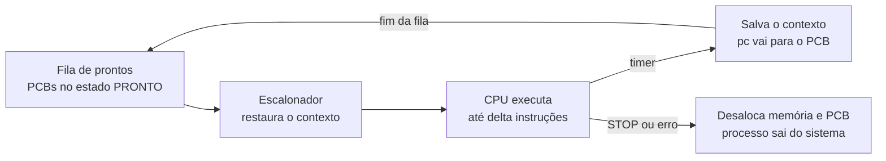

# Trabalho 1 de SO — Guia de Estudo

18/10/2026 · Guilherme Guimarães Santos

## Visão geral

O Trabalho 1 constrói um sistema operacional simples em cima de uma máquina virtual (MV) simulada em Java. Cada fase acrescenta uma peça do SO sobre a anterior. Todo o código fica em `Sistema.java`, em classes aninhadas.

| Fase | Enunciado | O que entra | Conceito de SO |
| --- | --- | --- | --- |
| HW | 01 | CPU, memória, instruções, interrupções (fornecido pelo professor) | Ciclo de busca e execução |
| 1A | 02 | Gerente de Memória | Paginação |
| 1B | 03 | Gerente de Processos + shell | Processo, PCB, fila de prontos |
| 1C | 04 | Escalonador + thread de escalonamento | Round-robin, troca de contexto, concorrência |

O enunciado 05 é o esquema de referência: diagramas da arquitetura sequencial, multithread e multithread com E/S. A versão com E/S fica para depois do T1.

## Hardware simulado (HW)

A MV é o "computador" sobre o qual o SO roda. Ela não muda entre as fases, e os programas de teste nunca são alterados.

- **Memória (`Memory`, `Word`):** um array de palavras. Cada palavra tem `opc` (opcode), `ra`, `rb` e `p` (parâmetro). `DATA` marca uma palavra de dado.
- **CPU:** `pc`, `ir` (instrução atual) e 8 registradores `reg[0..7]`. `reg[8]` e `reg[9]` passam os parâmetros das chamadas de sistema.
- **Ciclo de instrução (`CPU.run`):** busca a instrução em `pc`, executa e, ao final, verifica se há interrupção.
- **Interrupções:** `intEnderecoInvalido`, `intInstrucaoInvalida`, `intOverflow` e, a partir do 1C, `intTimer`. Qualquer uma desvia para a rotina de tratamento do SO.
- **Chamadas de sistema:** `STOP` termina o processo; `SYSCALL` com `reg[8]=2` escreve na tela (`OUT:`). A leitura (`reg[8]=1`) ainda é um stub.

## Paginação e Gerente de Memória (1A)

Paginação deixa um processo ocupar pedaços espalhados da memória, sem precisar de um bloco contínuo. O programa continua "achando" que está contínuo a partir do endereço 0.

**Conceitos**

- A memória física é dividida em **frames** de `tamPg` palavras; o programa, em **páginas** do mesmo tamanho. Com 1024 palavras e páginas de 8, são 128 frames.
- A **tabela de páginas** do processo diz em que frame está cada página: `tabelaPaginas[pagina] = frame`.
- O programa usa **endereços lógicos**; a CPU traduz cada acesso para o **endereço físico**:

```math
\text{fisico} = \text{tabelaPaginas}[\lfloor e / tamPg \rfloor] \times tamPg + (e \bmod tamPg)
```

**Exemplo da apresentação:** `fibonacci10` com páginas `[5, 6, 9, 10]`. O endereço lógico 16 cai na página 2, que está no frame 9: 9 × 8 + 0 = 72.

**Como implementamos**

- `GerenteMemoria.aloca(nroPalavras)`: devolve a tabela de páginas, ou `null` se não há frames livres suficientes. Limpa cada frame antes de entregá-lo.
- `desaloca(tabelaPaginas)`: só marca os frames como livres. O conteúdo fica visível no `dumpM` até o frame ser reaproveitado.
- `Utilities.carregaPaginado`: copia cada página do programa para o seu frame.
- `CPU.traduz`: faz a tradução em todo acesso à memória. Se a página não existe na tabela, gera `intEnderecoInvalido`. Essa é a **proteção de memória**: um processo não enxerga a memória de outro.

## Processos, PCB e shell (1B)

Um **processo** é um programa carregado na memória e pronto para rodar. O SO controla cada processo pelo seu **PCB** (Process Control Block).

**Conceitos**

- **PCB:** a ficha do processo, com `id`, estado, tamanho, tabela de páginas e, a partir do 1C, o contexto salvo (`pc` e registradores).
- **Fila de prontos:** os PCBs que podem ganhar a CPU.
- **Running:** ponteiro para o único processo que está na CPU agora.
- **Estados no nosso SO:** `PRONTO` (na fila) e `RODANDO` (na CPU). Quando termina, o processo some.

**Como implementamos (`GerenteProcessos`)**

- `criaProcesso(imagem)`: pede frames ao GM, carrega o programa, cria o PCB e o coloca na fila de prontos. Devolve o `id`, ou `-1` sem memória.
- `tentaRemover(id)`: desaloca memória e PCB. Recusa se o processo estiver `RODANDO`.
- `Shell`: lê um comando por linha (`new`, `rm`, `ps`, `dump`, `dumpM`, `exec`, `execAll`, `traceOn`/`traceOff`, `exit`, e os de demonstração `pause`, `resume`, `delay`). Entrada inválida só imprime uma mensagem de uso.

O uso de cada comando está no `roteiro-apresentacao.md`.

## Escalonamento round-robin e troca de contexto (1C)

Cada processo usa a CPU por uma **fatia de tempo** de `delta` instruções. Depois, dá a vez ao próximo da fila. Assim todos avançam em rodízio.



*A cada `delta` instruções, o processo volta ao fim da fila; `STOP` ou erro o retiram do sistema.*

**Conceitos**

- **Relógio:** o enunciado permite um contador de instruções em vez de um relógio real. A cada `delta` instruções, a CPU liga a interrupção `intTimer`.
- **Contexto:** o estado da CPU que pertence ao processo (`pc` + registradores). É salvo no PCB na saída e restaurado na volta, para o processo continuar de onde parou.
- **Fim de processo:** `STOP` é uma chamada de sistema; o SO libera memória e PCB e escalona outro.

**Como implementamos**

- `CPU.setContext(pcb)` faz `reg = pcb.reg`: os registradores da CPU *são* os do PCB enquanto o processo roda. Na preempção, só o `pc` precisa ser copiado (`salvaContexto`).
- `InterruptHandling`: `intTimer` salva o contexto e devolve o processo ao fim da fila; qualquer outra interrupção finaliza o processo. Os dois casos terminam chamando `escalonador.escalona()`.
- `execAll`: espera até não sobrar processo (e retoma o escalonador, se estiver pausado).

## Execução contínua com threads (1C, §3.2)

O enunciado pede que o escalonamento não dependa de um comando: basta existir processo para ele rodar. Para isso o SO precisa de no mínimo duas threads.

| Thread | O que faz |
| --- | --- |
| Shell (principal) | Lê e executa os comandos do usuário |
| `ThreadEscalonador` | Em laço: se a CPU está livre, escalona; se há processo, roda uma fatia; senão, dorme 20 ms |

**Concorrência:** as duas threads mexem nas mesmas filas. Por isso:

- todo método do `GerenteProcessos` é `synchronized`;
- `escalonaProximo()` tira o processo da fila e o marca `RODANDO` num só passo. Separado, um `rm` no meio do caminho liberaria os frames do processo que ia rodar;
- o Shell nunca toca na CPU. `exec <id>` só coloca o processo no início da fila;
- as saídas no console usam `synchronized (System.out)` para o texto das duas threads não se misturar.

O enunciado 05 mostra uma versão mais elaborada, com semáforos (`semaSch`, `semaCPU`). Nós usamos um laço simples com espera (polling), que atende ao requisito.

## Decisões de projeto e pontos de atenção

| Decisão | Por quê |
| --- | --- |
| `aloca` devolve `int[]` ou `null`, em vez de `boolean` + parâmetro de saída | Mais natural em Java; mesmo efeito |
| Frames limpos na alocação, não na liberação | Um processo novo nunca lê lixo de outro, e o resultado de quem terminou continua visível (§3.1) |
| `reg` do CPU aponta para o `reg` do PCB | Troca de contexto sem copiar registradores |
| Processo desalocado assim que termina | O enunciado 04 §2.2 manda liberar memória e PCB no `STOP` |
| Comandos `pause`, `resume`, `delay` | Sem eles, os programas terminam em milissegundos e não dá para mostrar `ps`/`dump` |

**Se o professor perguntar**

- **PB e PC dão `intEnderecoInvalido`:** acessam endereços além da própria imagem (50; 96–99). Como a alocação é pelo tamanho do programa e os programas não podem mudar, é a proteção de memória agindo.
- **`fibonacciREAD` não gera a série:** a syscall de leitura é um stub, como no código original.
- **`dump` de um processo rodando pode mostrar `pc` e registradores "atrasados":** a leitura não trava o processo. É só uma foto de depuração; os dados não se corrompem.

## Perguntas para revisar

- [ ] Com memória de 1024 e página de 16, quantos frames há? E quantas páginas ocupa um programa de 30 palavras?
- [ ] Um processo tem páginas `[2, 7]` e página de 8. Qual o endereço físico do lógico 10?
- [ ] Por que paginação evita a fragmentação externa?
- [ ] O que fica guardado no PCB, e por que o `pc` precisa ser salvo na preempção?
- [ ] O que acontece com um processo no fim da fatia de tempo? E no `STOP`?
- [ ] O que muda no comportamento com `delta` = 1 e com `delta` = 1000?
- [ ] Por que o SO precisa de duas threads no §3.2, e qual dado elas compartilham?
- [ ] Que corrida o `escalonaProximo()` atômico evita?

Respostas das duas primeiras: 64 frames e 2 páginas; 7 × 8 + 2 = 58.
